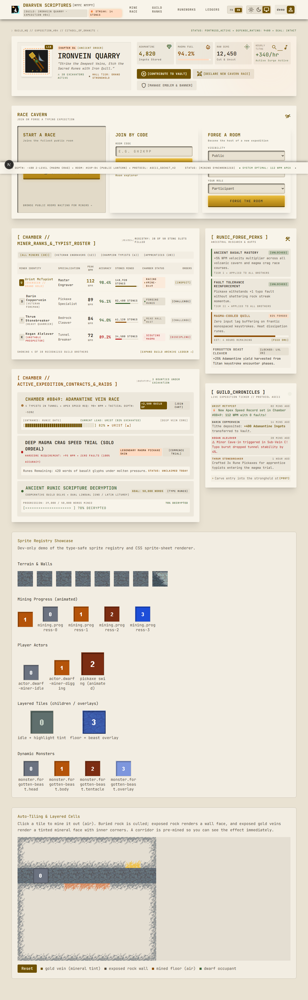
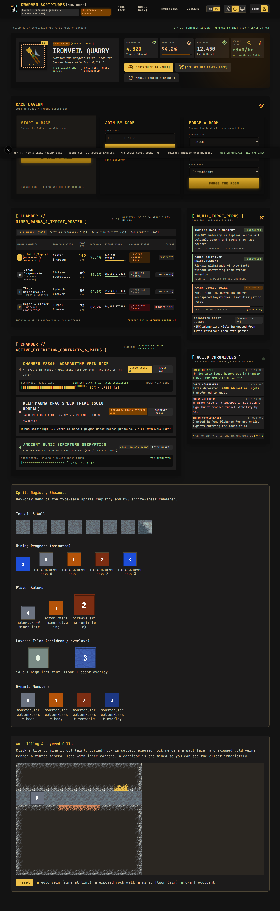
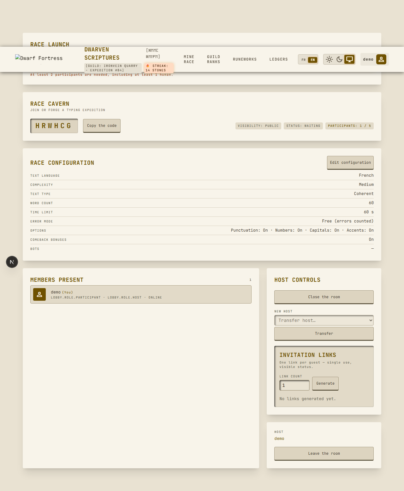
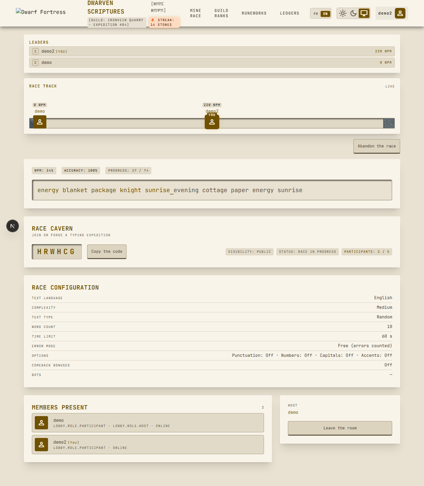
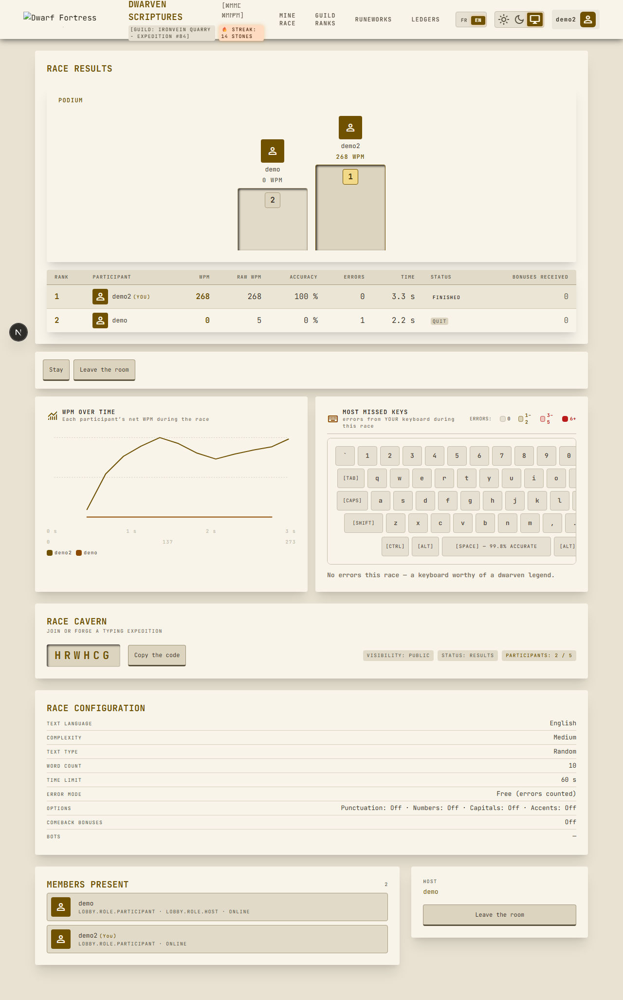
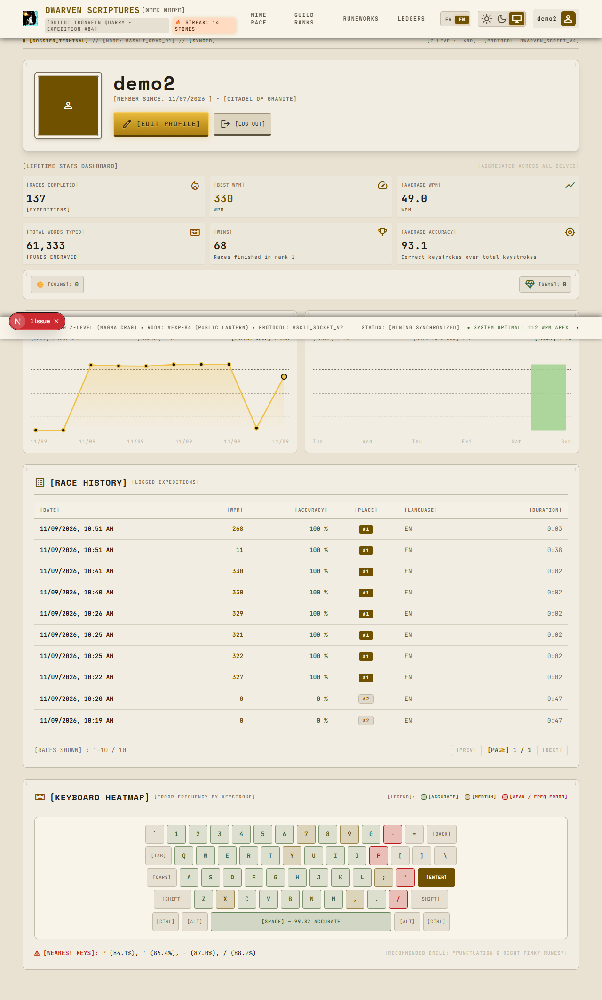

# Dwarven scriptures

Competitive typing-race web app for students (Monkeytype × Kahoot style), set in
a Dwarf-Fortress-inspired cave: players join a room by a short code, type the
same text and race in real time with a live progress track, bots, comeback
bonuses, results and personal statistics. The progress track — a stone tunnel
built from the theme's sprite tiles — is the signature element of the visual
identity.

**Live in production:** <https://dwarven-scriptures.up.railway.app>

## Screenshots

| | |
| --- | --- |
|  |  |
|  |  |
|  |  |

## What it does

* **Rooms**: create a room as host (participant or spectator), join by 6-char
  code, quick play, public explorer with filters, invitation links, host
  handover, kicks.
* **Race**: synchronized 3-2-1 countdown, same text for everyone, two error
  modes (free / blocking), live progress track with interpolation, top 3,
  overtake warnings, personal-record badge.
* **Bots**: five levels (noob → impossible) with variable speed, errors and
  correction delays, deterministic from a seed.
* **Comeback bonuses**: three effects applied server-side at the 25/50/75 %
  checkpoints (extend the leader's text, shorten the trailer's text, fog).
* **Results & stats**: podium, full table, WPM-over-time chart, per-race key
  heatmap, persisted race history with replay pages and account statistics.
* **Accounts**: password login + GitHub/Discord OAuth, guest sessions with a
  chosen nickname, avatar upload.
* **UX**: French/English UI, light/dark themes (system preference by default,
  no wrong-theme flash), responsive from 360 px — on mobile the race is
  replaced by a physical-keyboard notice.

## Technologies

* [Next.js](https://nextjs.org) 16 (App Router) + React 19 + TypeScript
  (`strict: true`, no explicit `any`) + Tailwind CSS
* PostgreSQL + [Drizzle ORM](https://orm.drizzle.team) (committed migrations,
  idempotent seed script)
* [Zod](https://zod.dev) v4 validates every server-side input: server actions,
  API routes and real-time messages
* Real-time transport: a `ws` WebSocket server on the same process as Next.js,
  via a custom server (`tsx server.ts`) — one process, one port (ADR-010 in
  [`doc/ARCHITECTURE.md`](doc/ARCHITECTURE.md))
* Jest + Testing Library for unit tests, Playwright for E2E, GitHub Actions CI
* Deployed on [Railway](https://railway.app) in HTTPS

## Local setup

Prerequisites: Node.js ≥ 22, npm (the repo pins `npm@11.19.0`) and Docker
(Docker Compose) for the local PostgreSQL.

```bash
npm install
cp .env.example .env.local   # fill DATABASE_URL and SESSION_SECRET
npm run db:docker            # start local PostgreSQL 16 on port 5432
npm run db:migrate           # apply the committed Drizzle migrations
npm run db:seed              # seed corpus, word dictionaries and demo accounts
npm run dev                  # custom server on http://localhost:3000
```

Open <http://localhost:3000>.

## Environment variables

Every variable is documented in [`.env.example`](.env.example); nothing else is
needed and no secret is committed:

| Variable | Purpose |
| --- | --- |
| `DATABASE_URL` | PostgreSQL connection string (local or Railway reference) |
| `SESSION_SECRET` | Signs the session cookie (generate with `openssl rand -base64 32`) |
| `WS_ALLOWED_ORIGINS` | Comma-separated extra origins allowed to open `/ws`; same-origin is always accepted |
| `NEXT_PUBLIC_WS_URL` | Optional socket URL override — leave empty, the default is same-origin `/ws` |
| `PORT` / `HOSTNAME` | Custom server port (default 3000) and bind address (default `::`) |
| `GITHUB_CLIENT_ID` / `GITHUB_CLIENT_SECRET` | GitHub OAuth app (callback `/api/auth/github/callback`) |
| `DISCORD_CLIENT_ID` / `DISCORD_CLIENT_SECRET` | Discord application (callback `/api/auth/discord/callback`) |

OAuth is optional: the app degrades gracefully when the credentials are empty.

## Tests

| Command | Description |
| --- | --- |
| `npm run test` | Jest unit tests (single run) |
| `npm run typecheck` | `tsc --noEmit` with `strict: true` |
| `npm run lint` | ESLint |
| `npm run build` | Production build (`next build`) |
| `npm run test:e2e` | Playwright E2E suite |

The E2E suite deliberately does **not** manage its own server: start the whole
stack first (`db:docker`, `db:migrate`, `db:seed`, then `npm run dev` — the
suite assumes the app is already running on port 3000 with its WebSocket
endpoint). It runs Chromium only, with a single worker, against the seeded
database, and uses the password login (never OAuth). See
[`playwright.config.ts`](playwright.config.ts) for the rationale.

## Demo accounts

Seeded by `npm run db:seed` (password login — used by the E2E suite):

| Username | Password |
| --- | --- |
| `demo` | `demo-password-123` |
| `demo2` | `demo-password-123` |
| `demo3` | `demo-password-123` |

## Documentation

* [`AGENTS.md`](AGENTS.md) — project conventions for human and agent
  contributors
* [`doc/EXIGENCES.md`](doc/EXIGENCES.md) — full requirements matrix with
  honest statuses, files and tests
* [`doc/ARCHITECTURE.md`](doc/ARCHITECTURE.md) — data model, race state
  machine, ADRs, real-time message flow
* [`doc/database.md`](doc/database.md) — schema details, seed, environment
  variables and the Railway deployment playbook
* [`doc/DEMARCHE-CREATIVE.md`](doc/DEMARCHE-CREATIVE.md) — creative direction
  (name, logo, palettes)
* [`doc/IA.md`](doc/IA.md) — AI tools used and lessons learned
