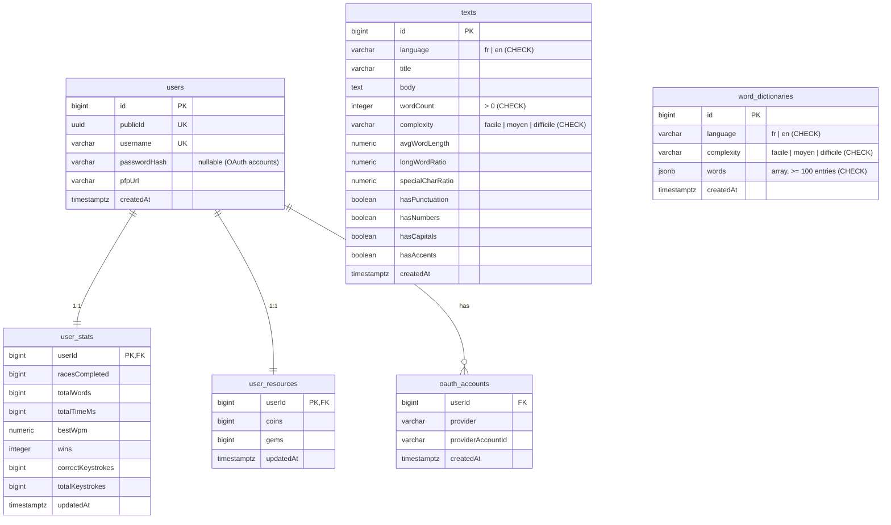
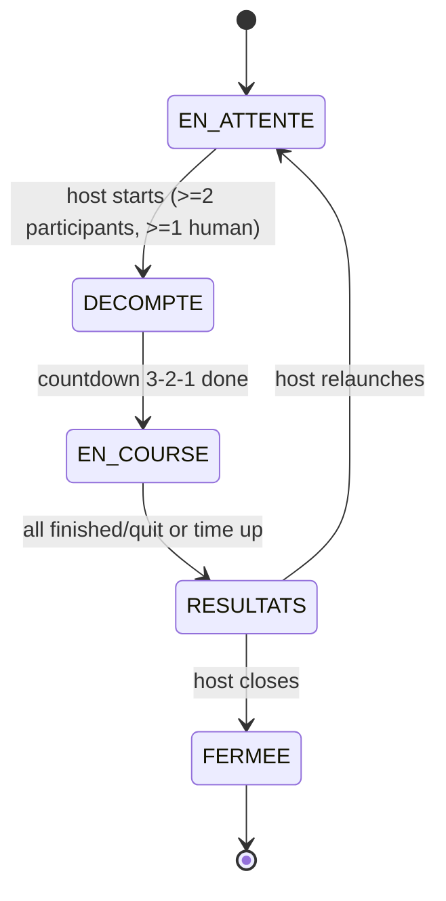
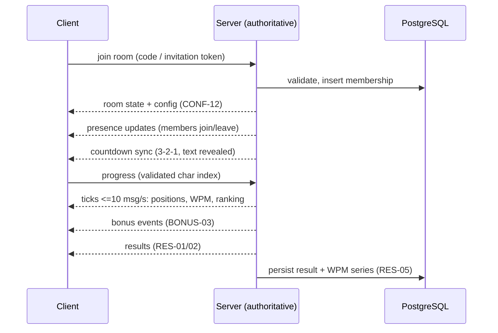

# Architecture

This document records the architecture decisions made so far and the planned
design for the parts that are not built yet. Decisions are written as ADRs
(Architecture Decision Records) at the bottom. **Sections marked *planned* are
design intentions, not implemented code** — do not treat them as done.

Current state: authentication (password + GitHub/Discord OAuth), the account
profile screen, the Dwarf-Fortress-inspired UI shell and the Drizzle/PostgreSQL
data layer (users plus the seeded `texts` corpus and `word_dictionaries` word
pools) are implemented. Rooms, the real-time layer, the race engine, bots
and bonuses are not built yet.

## Folder layout

| Path | Role |
| ---- | ---- |
| `src/app/` | Next.js App Router pages and route handlers (`(auth)/`, `login/`, `register/`, `account/`, `api/auth/[provider]/`) |
| `src/components/` | Presentational UI components (auth forms, account screen, theme shell) |
| `src/data/` | Static UI data (site identity, form labels, mock content) |
| `src/db/` | Drizzle schema (`schema.ts`), client, migration runner, `queries/` (one module per aggregate) |
| `src/lib/` | Pure business logic: password hashing, validation, sessions, OAuth |
| `src/sprites/` | Sprite registry, auto-tiling and tile rendering (the visual identity) |
| `drizzle/` | Generated SQL migrations + journal (committed, never hand-edited) |
| `stitch/` | Design mockup reference text |
| `doc/` | Documentation |

## Data model

### Current schema (implemented)

Rules: internal `id`s never reach the client (public ids are `publicId` /
`username`); `user_stats` carries `wins` plus keystroke counters — accuracy is
derived at read time (`correct / total * 100`, AUTH-06), not stored as a
column; `texts` and `word_dictionaries` are reference data whose complexity is
justified by measurable metrics (CONF-05, see `doc/database.md`); child rows
cascade on delete; all counters carry `CHECK >= 0`.

### Planned tables (design only)

Needed by the assignment requirements; the final schema will be added through
committed migrations when each feature is built:

* ~~`texts`~~ — **implemented** (see current schema): language, title, body,
  word count, complexity metrics and config flags
  (punctuation/numbers/capitals/accents) for CONF-03/05/07.
* ~~`word_dictionaries`~~ — **implemented** (see current schema): ≥100-word
  pools per (language, complexity) for random mode (CONF-03).
* `rooms` — host, 6-char code (SALLE-02 alphabet), visibility, capacity,
  status; unique constraint enforcing one room per person (SALLE-06).
* `room_members` — participants/spectators, join time (host handover uses
  longest-present human, SALLE-08), kick flag (SALLE-07).
* `invitation_links` — ≥ 128-bit token, status, bound IP, revoked flags
  (SALLE-04).
* `races` / `race_participants` — per-race config snapshot, start/end time,
  per-participant progress, errors, WPM series, bonuses received (RES-05),
  quit/status flags (COURSE-06/08/10).

## Race state machine (COURSE-01)

Only `EN_ATTENTE` and `RESULTATS` accept new members (SALLE-09). A disconnected
player who returns within 30 s resumes in place (COURSE-08).

## ADRs

### ADR-001 — Stack: Next.js App Router + React + TypeScript + Tailwind

* **Status:** Accepted
* **Context:** The assignment mandates Next.js (App Router) with React
  (TECH-01), 100 % TypeScript (TECH-02) and Tailwind (TECH-03).
* **Decision:** Next.js (current stable, v16) with the App Router, React 19,
  TypeScript with `strict: true`, and Tailwind CSS v3. Server actions are the
  mutation entry points; route handlers cover OAuth callbacks.
* **Consequences:** Server and client code share the repo; validation and
  business logic must live in plain modules (`src/lib`, `src/db/queries`) so
  they stay testable outside React. `.jsx` presentational files still exist and
  must be converted to satisfy TECH-02.

### ADR-002 — Database: PostgreSQL + Drizzle with committed migrations

* **Status:** Accepted
* **Context:** PostgreSQL is required (TECH-04); the ORM was free. The app must
  survive schema evolution on a deployed instance.
* **Decision:** Drizzle ORM over `pg`; schema in `src/db/schema.ts`; generated
  SQL migrations in `drizzle/` are committed and applied with
  `npm run db:migrate`. `db:push`/`db:studio` are local-only conveniences.
* **Consequences:** Everything reachable from the schema file must live in
  `pg-core` modules; types are inferred from the schema. Changes that must reach
  shared databases go through migrations, never `db:push`.

### ADR-003 — Sessions: stateless signed cookie, no auth library

* **Status:** Accepted
* **Context:** Needed sessions for both password and OAuth login with minimal
  dependencies and no server state.
* **Decision:** A `body.signature` token in an HttpOnly cookie
  (`session`, 30 days or browser session), HMAC-SHA256 via Node's built-in
  `crypto`, verified with `timingSafeEqual`. Payload is `{ publicId, username,
  exp }`. No session table, no auth dependency.
* **Consequences:** Sessions cannot be revoked server-side. If "log out all
  devices" becomes required, migrate to a database-backed session table without
  changing the login result contract (see `doc/auth.md`).

### ADR-004 — OAuth: hand-rolled authorization-code flow (GitHub + Discord)

* **Status:** Accepted
* **Context:** AUTH-01 requires both GitHub and Discord OAuth. An auth library
  was rejected to keep the dependency surface small.
* **Decision:** Authorization-code flow with a CSRF `state` (short-lived
  HttpOnly cookies), no PKCE (confidential server client with a secret).
  Scopes: GitHub `read:user`, Discord `identify` (no email). Provider identities
  link to users through `oauth_accounts` (`createOrLinkOAuthUser`, find-or-create
  in one transaction, username collision retried with a random suffix).
* **Consequences:** Provider logic is `src/lib/oauth.ts` + two route handlers;
  failures always degrade to a `/login` redirect without revealing details.

### ADR-005 — Password hashing: scrypt via `node:crypto`

* **Status:** Accepted
* **Context:** SEC-03 allows Argon2, bcrypt or scrypt. Passwords must never be
  stored or logged in clear.
* **Decision:** scrypt (RFC 7914) with `N=2^15`, `r=8`, `p=1`, 64-byte key,
  16-byte random salt, 64 MiB maxmem, stored in a self-describing
  `scrypt$N$r$p$salt$hash` envelope.
* **Consequences:** Memory-hard without native addons (NIST SP 800-132, OWASP
  listed). Raising parameters later only changes `deriveKey`; the envelope
  format stays. Argon2id migration remains possible by swapping the prefix.

### ADR-006 — Identity: username is the display name; no email

* **Status:** Accepted
* **Context:** The product only needs a display name; email was removed early.
* **Decision:** `users.username` stores the trimmed display name (≤ 32 chars,
  unique, internal spaces allowed); OAuth accounts have `passwordHash = NULL`.
  Login errors never reveal whether an account exists.
* **Consequences:** No email-based recovery or notifications. Renaming keeps
  the uniqueness constraint; E2E tests will use the password login (TEST-03).

### ADR-007 — Visual identity: Dwarf-Fortress-inspired ASCII/tile system

* **Status:** Accepted
* **Context:** DES-04 demands a unique, non-default look; the human-chosen
  identity is "Dwarven scriptures" (see `doc/DEMARCHE-CREATIVE.md`).
* **Decision:** A pixel/ASCII "dwarf fortress" direction rendered through a
  sprite registry and an auto-tiling engine (`src/sprites/`), a cave shell for
  auth screens, and themed UI components (guild banner, miner roster, perks).
  Mockups are drafted in `stitch/` before components are solidified.
* **Consequences:** New UI must extend the sprite/tile system instead of
  importing generic component libraries. The signature progress track
  (DES-04) will be built in this style.

### ADR-008 — Testing: Jest + Testing Library, live-schema verification

* **Status:** Accepted
* **Context:** Unit tests are required (TEST-01) and CI will run them (TECH-09).
* **Decision:** Jest with jsdom, co-located `*.test.ts(x)` files; business logic
  tested as pure functions; DB queries tested with mocked clients plus a real
  `npm run db:verify` check for column defaults, cascades and CHECK constraints.
* **Consequences:** Playwright E2E (TEST-02) is planned but not installed yet;
  no `.github/workflows` CI exists yet either.

### ADR-009 — Environments: Docker Compose locally, Railway in production

* **Status:** Accepted
* **Context:** TECH-04/05 want reproducible local PostgreSQL and a cheap HTTPS
  deployment.
* **Decision:** Local PostgreSQL 16 via `docker-compose.yml` (volume-backed);
  deployment targeted at Railway with TLS auto-enabled in production
  (`src/db/index.ts` detects `NODE_ENV=production`/`railway`).
* **Consequences:** One local Postgres on port 5432 at a time. The production
  URL and environment remain to be confirmed for TECH-05.

### ADR-010 — Real-time transport *(proposed — decision pending)*

* **Status:** Proposed
* **Context:** TECH-06 leaves the technology free; checkpoint 1 requires the
  decision as an ADR and live room presence (SALLE-01/02 + JOIN-01). Constraint
  set: server-authoritative progress/ranking/bonuses (COURSE-06), ≤ 10
  progress messages/s/player (PERF-02), 30 s reconnection resume (COURSE-08),
  up to 30 participants (SALLE-05), room-level channels.
* **Options considered:**
  1. **Socket.IO** — rooms/namespaces, auto-reconnect, widely understood;
     heavier dependency, an abstraction layer to fight.
  2. **`ws` on a Node server (or Next.js custom server)** — minimal, full
     control of the protocol; rooms/reconnection hand-written.
  3. **SSE + POST fallback** — simple, one-way only; forces request/response
     semantics for typing events.
* **Lean:** `ws` (or Socket.IO if message volume proves trivial) with
  server-issued ticks and client-side interpolation (COURSE-05 wants ~4
  perceived updates/s from ≤ 10 real messages/s). The transport stays behind an
  interface so game logic never imports it directly (AGENTS.md).
* **Open question:** hosting story (Railway WebSockets, separate service, or
  free-tier real-time provider per TECH-08). Decision will be finalized when
  rooms are implemented.

### ADR-011 — Bots *(proposed approach)*

* **Status:** Proposed
* **Context:** BOT-01..05: five levels, variable speed, errors with correction
  time, bonus-aware, deterministic from a seed.
* **Decision (intent):** Bots drive the same race model as humans — a
  deterministic simulation seeded per bot/race generates a per-character
  schedule (accelerations, hesitations, hard-word slowdowns, injected errors
  plus correction delay). The error behavior follows the configured error mode
  (CONF-08). No bot-specific code paths in the race engine itself.
* **Consequences:** The whole bot engine is unit-testable from its seed
  (BOT-05); the five level ranges (BOT-01) map to schedule parameters to be
  documented when implemented.

## Planned real-time message flow *(design only)*

Rules the flow must respect: the server validates every progress message and
rejects impossible jumps (COURSE-06); per-keystroke writes to the database are
forbidden (PERF-02); the track interpolates client-side between ticks
(COURSE-05); a reconnect within 30 s resumes the race where it left off
(COURSE-08).
