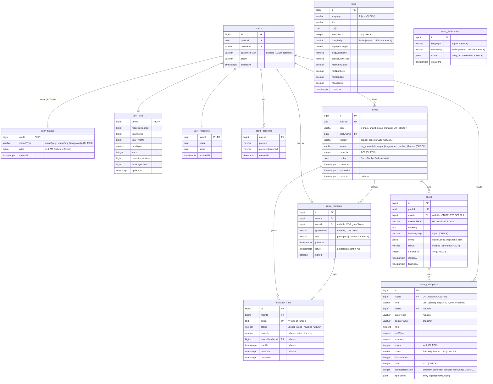
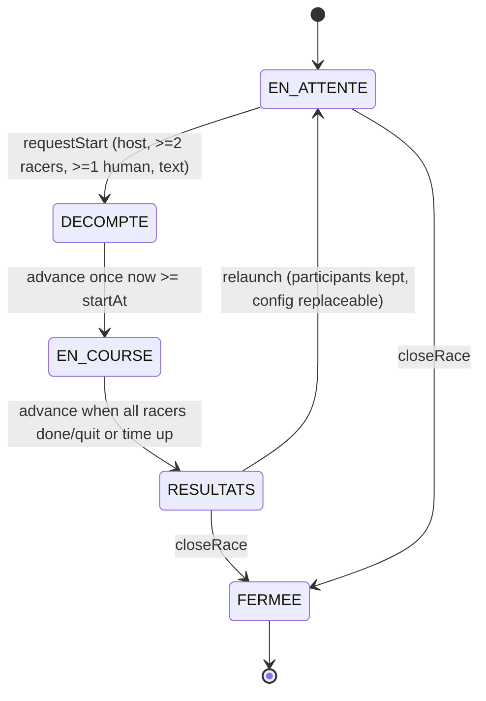
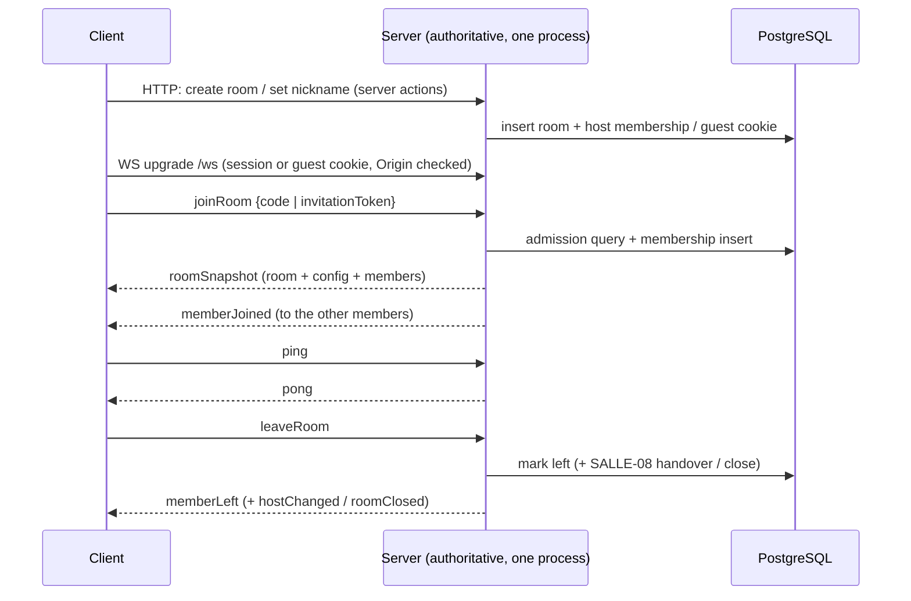
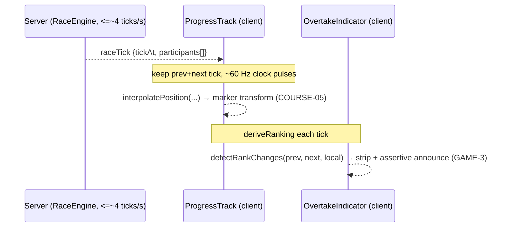
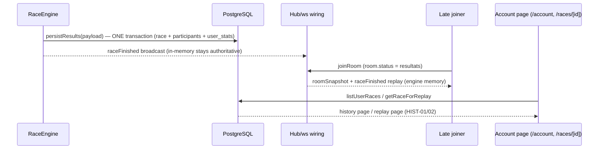

# Architecture

This document records the architecture decisions made so far and the planned
design for the parts that are not built yet. Decisions are written as ADRs
(Architecture Decision Records) at the bottom. **Sections marked *planned* are
design intentions, not implemented code** — do not treat them as done.

Current state: authentication (password + GitHub/Discord OAuth), the account
profile screen, the Dwarf-Fortress-inspired UI shell, the Drizzle/PostgreSQL
data layer (users plus the seeded `texts` corpus and `word_dictionaries` word
pools) and the rooms data layer (`rooms`, `room_members`, `invitation_links`,
queries, rules, actions) are implemented. The realtime layer is implemented
for checkpoint 1 (ADR-010, Decision A): a `ws` server on the same HTTP server
as Next.js (`server.ts` custom server), a Zod-validated protocol
(`src/realtime/protocol.ts`), a transport-agnostic room hub
(`src/realtime/hub.ts`) with presence/heartbeat/kick/close/config broadcasts,
the Postgres adapter (`src/realtime/room-store.ts`), the action→hub bridge
(`src/realtime/events.ts`) and the typed client hook
(`src/realtime/useRoomSocket.ts`). The room UI exists for checkpoint 1: home
race section (quick play, join by code, create-room card),
`/rooms` public explorer with filters and ~5 s auto-refresh,
`/rooms/[publicId]` lobby (live member list, host controls, invitation
links), guest nickname flow and the `/i/[token]` invitation endpoint. The
race **domain logic** is implemented as pure modules (`src/lib/race/`): the
state machine (COURSE-01), the Annexe A WPM formulas (`stats.ts`), the seeded
random-text generator, the coherent-text selection ranking and the race
start rules. The realtime race wiring (start command, progress stream,
results broadcast) is implemented, and **results persistence + history +
replay landed in SP-3B** (RES-05, HIST-01/02 — see
[Persistence and replay](#persistence-and-replay-res-05-hist-0102)); **bots
landed in Phase 4** (ADR-011) and **comeback bonuses are applied server-side
in Phase 4** (BONUS-01..04 — see [Comeback bonuses](#comeback-bonuses-bonus-0104)):
the pure rules, the engine integration, the protocol messages and the client
state are done; the **visual** bonus announcements (track banners, the 2 s
fog, the text adjustment rendering) landed in SP-4C (BONUS-03).

## Folder layout

| Path | Role |
| ---- | ---- |
| `src/app/` | Next.js App Router pages and route handlers (`(auth)/`, `login/`, `register/`, `account/`, `rooms/` server actions, `api/auth/[provider]/`) |
| `src/components/` | Presentational UI components (auth forms, account screen, theme shell) |
| `src/data/` | Static UI data (site identity, form labels, mock content) |
| `src/db/` | Drizzle schema (`schema.ts`), client, migration runner, `queries/` (one module per aggregate) |
| `src/lib/` | Pure business logic: password hashing, validation, sessions, OAuth, token codecs, rate limiting, i18n, avatar upload, room rules, the race domain (`race/`: state machine, stats, text generation/selection, typing, track, bonuses) and the bot schedule (`bots/schedule.ts`) |
| `src/realtime/` | Realtime layer: `protocol.ts` (Zod schemas), `hub.ts` (transport-agnostic hub), `room-store.ts` (Postgres adapter), `server.ts` (ws wiring), `events.ts` (action→hub bridge), `useRoomSocket.ts` (client hook) |
| `src/sprites/` | Sprite registry, auto-tiling and tile rendering (the visual identity) |
| `server.ts` | Custom server entry (ADR-010): one process for Next.js + the `/ws` realtime layer |
| `drizzle/` | Generated SQL migrations + journal (committed, never hand-edited) |
| `stitch/` | Design mockup reference text |
| `doc/` | Documentation |

## Data model

### Current schema (implemented)



Rules: internal `id`s never reach the client (public ids are `publicId` /
`username` / the room `code`; members are addressed by their user `publicId`
or guest token); `user_stats` carries `wins` plus keystroke counters — accuracy
is derived at read time (`correct / total * 100`, AUTH-06), not stored as a
column; `texts` and `word_dictionaries` are reference data whose complexity is
justified by measurable metrics (CONF-05, see `doc/database.md`); child rows
cascade on delete; all counters carry `CHECK >= 0`. The room tables implement
SALLE-01..10: the 6-char code alphabet is enforced by CHECK, "one active room
per person" (SALLE-06) is a database guarantee via two partial unique indexes
on `room_members` (`WHERE leftAt IS NULL`), the config jsonb is Zod-validated
on every write (CONF-01..12), and invitation tokens are ≥ 128-bit random
(SALLE-04) — details in `doc/database.md`.

### Planned tables (design only)

Needed by the assignment requirements, originally sketched here and since
built through committed migrations as each feature landed:

* ~~`texts`~~ — **implemented** (see current schema): language, title, body,
  word count, complexity metrics and config flags
  (punctuation/numbers/capitals/accents) for CONF-03/05/07.
* ~~`word_dictionaries`~~ — **implemented** (see current schema): ≥100-word
  pools per (language, complexity) for random mode (CONF-03).
* ~~`rooms`~~ — **implemented** (see current schema): host, 6-char code
  (SALLE-02 alphabet), visibility, capacity, status, Zod-validated `config`
  jsonb.
* ~~`room_members`~~ — **implemented** (see current schema): participants/
  spectators, join time (host handover uses the longest-present human,
  SALLE-08), kick flag (SALLE-07), partial unique indexes enforcing one
  active room per person (SALLE-06).
* ~~`invitation_links`~~ — **implemented** (see current schema): ≥ 128-bit
  token, status, bound IP + membership, revoked timestamps (SALLE-04).
* `races` / `race_participants` — **implemented** (SP-3B): per-race config
  snapshot, start/end time, text and language, per-participant progress,
  errors, WPM series, rank and status (RES-05), plus the history/replay
  queries (HIST-01/02) — see the persistence flow below.

## Race state machine (COURSE-01)

**Implemented** as a pure, clock-injected module: `src/lib/race/state.ts`
(unit-tested exhaustively in `src/lib/race/state.test.ts` — every transition,
every guard rejection and the countdown boundaries). The diagram below is
exactly what the code enforces:



Phase values are the `rooms.status` strings (`en_attente`, `decompte`,
`en_course`, `resultats`, `fermee`); `src/lib/race/start-rules.ts` owns the
room-status ↔ race-phase mapping (`roomStatusForPhase`, identity today) as
the single source of truth. Semantics as implemented:

* **Countdown (COURSE-03):** `requestStart` stamps `startedAt = now` and
  `startAt = now + 3000 ms` (`COUNTDOWN_MS`) and stores the chosen text on
  the race at that moment — the text is revealed from the very start of the
  countdown (`textVisibleForPhase`). Any client joining mid-countdown derives
  its remaining seconds from `countdownSecondsRemaining` (3 → 1, `0` past the
  boundary); `advance` flips to `en_course` once `startAt` passes. The clock
  is injected (`now`), so the whole machine is deterministic in tests.
* **End conditions (COURSE-09):** in `en_course`, `advance` moves to
  `resultats` when every racing participant (spectators excluded, bots
  included) has a `finished`/`quit` result, or when
  `config.timeLimitSeconds` (if set) has elapsed since `startAt` — the still
  active participants are then recorded as `timeout` at that instant and
  `finishedAt` is stamped. `finishParticipant` only records a result (it is
  idempotent and cannot change the phase); the transition belongs to
  `advance`, the single place where a clock decides.
* **Relaunch / close (COURSE-11):** `relaunch` is legal only from
  `resultats`, keeps the participant list and can replace the config
  snapshot; `closeRace` is legal from `en_attente` or `resultats`.
* **Config snapshot (CONF-12):** the engine reads `rooms.config` exactly
  once, when a race starts (`RaceEngine.startRace` → `loadRoom` →
  `pickText` + `createRace({ config })`). From DÉCOMPTE on, the running race
  is immune to any later change, so the `updateRoomConfig` query refuses
  writes while `rooms.status` is not `en_attente` (`RoomConfigLockedError`
  → action code `configLocked` → localized denial in the lobby). The guard
  is deliberately strict (`en_attente` only): the results screen
  (COURSE-11, Phase 3) can widen it to `resultats` safely, because the next
  `startRace` (relaunch) re-reads the stored config — this keeps the DB
  config and the engine snapshot coherent at all times. Live updates to
  everyone present flow through `configUpdated` (see the message-flow
  section below).
* **Annexe A formulas** (net/raw WPM, accuracy, progression) live in
  `src/lib/race/stats.ts` so every phase reuses them verbatim (COURSE-04/10).

The machine is pure data in / data out — the realtime wiring (start-command
authorization against `rooms.hostUserId`, progress validation, broadcasts,
bonus application and persistence) is implemented in
`src/realtime/race-engine.ts` (SP-2B → SP-4B) and described by the race
message flow below.

Only `EN_ATTENTE` and `RESULTATS` accept new members (SALLE-09). A disconnected
player who returns within 30 s resumes in place (COURSE-08).

## ADRs

### ADR-001 — Stack: Next.js App Router + React + TypeScript + Tailwind

* **Status:** Accepted
* **Context:** The assignment mandates Next.js (App Router) with React
  (TECH-01), 100 % TypeScript (TECH-02) and Tailwind (TECH-03).
* **Decision:** Next.js (current stable, v16) with the App Router, React 19,
  TypeScript with `strict: true`, and Tailwind CSS v3. Server actions are the
  mutation entry points; route handlers cover OAuth callbacks.
* **Consequences:** Server and client code share the repo; validation and
  business logic must live in plain modules (`src/lib`, `src/db/queries`) so
  they stay testable outside React. TECH-02 is satisfied: the repo contains no
  `.js`/`.jsx` source files (the historical `.jsx` components were converted
  and `tailwind.config.js` renamed to `.cjs`).

### ADR-002 — Database: PostgreSQL + Drizzle with committed migrations

* **Status:** Accepted
* **Context:** PostgreSQL is required (TECH-04); the ORM was free. The app must
  survive schema evolution on a deployed instance.
* **Decision:** Drizzle ORM over `pg`; schema in `src/db/schema.ts`; generated
  SQL migrations in `drizzle/` are committed and applied with
  `npm run db:migrate`. `db:push`/`db:studio` are local-only conveniences.
* **Consequences:** Everything reachable from the schema file must live in
  `pg-core` modules; types are inferred from the schema. Changes that must reach
  shared databases go through migrations, never `db:push`.

### ADR-003 — Sessions: stateless signed cookie, no auth library

* **Status:** Accepted
* **Context:** Needed sessions for both password and OAuth login with minimal
  dependencies and no server state.
* **Decision:** A `body.signature` token in an HttpOnly cookie
  (`session`, 30 days or browser session), HMAC-SHA256 via Node's built-in
  `crypto`, verified with `timingSafeEqual`. Payload is `{ publicId, username,
  exp }`. No session table, no auth dependency.
* **Consequences:** Sessions cannot be revoked server-side. If "log out all
  devices" becomes required, migrate to a database-backed session table without
  changing the login result contract (see `doc/auth.md`).

### ADR-004 — OAuth: hand-rolled authorization-code flow (GitHub + Discord)

* **Status:** Accepted
* **Context:** AUTH-01 requires both GitHub and Discord OAuth. An auth library
  was rejected to keep the dependency surface small.
* **Decision:** Authorization-code flow with a CSRF `state` (short-lived
  HttpOnly cookies), no PKCE (confidential server client with a secret).
  Scopes: GitHub `read:user`, Discord `identify` (no email). Provider identities
  link to users through `oauth_accounts` (`createOrLinkOAuthUser`, find-or-create
  in one transaction, username collision retried with a random suffix).
* **Consequences:** Provider logic is `src/lib/oauth.ts` + two route handlers;
  failures always degrade to a `/login` redirect without revealing details.

### ADR-005 — Password hashing: scrypt via `node:crypto`

* **Status:** Accepted
* **Context:** SEC-03 allows Argon2, bcrypt or scrypt. Passwords must never be
  stored or logged in clear.
* **Decision:** scrypt (RFC 7914) with `N=2^15`, `r=8`, `p=1`, 64-byte key,
  16-byte random salt, 64 MiB maxmem, stored in a self-describing
  `scrypt$N$r$p$salt$hash` envelope.
* **Consequences:** Memory-hard without native addons (NIST SP 800-132, OWASP
  listed). Raising parameters later only changes `deriveKey`; the envelope
  format stays. Argon2id migration remains possible by swapping the prefix.

### ADR-006 — Identity: username is the display name; no email

* **Status:** Accepted
* **Context:** The product only needs a display name; email was removed early.
* **Decision:** `users.username` stores the trimmed display name (≤ 32 chars,
  unique, internal spaces allowed); OAuth accounts have `passwordHash = NULL`.
  Login errors never reveal whether an account exists.
* **Consequences:** No email-based recovery or notifications. Renaming keeps
  the uniqueness constraint; E2E tests will use the password login (TEST-03).

### ADR-007 — Visual identity: Dwarf-Fortress-inspired ASCII/tile system

* **Status:** Accepted
* **Context:** DES-04 demands a unique, non-default look; the human-chosen
  identity is "Dwarven scriptures" (see `doc/DEMARCHE-CREATIVE.md`).
* **Decision:** A pixel/ASCII "dwarf fortress" direction rendered through a
  sprite registry and an auto-tiling engine (`src/sprites/`), a cave shell for
  auth screens, and themed UI components (guild banner, miner roster, perks).
  Mockups are drafted in `stitch/` before components are solidified.
* **Consequences:** New UI must extend the sprite/tile system instead of
  importing generic component libraries. The signature progress track
  (DES-04) will be built in this style.

### ADR-008 — Testing: Jest + Testing Library, live-schema verification

* **Status:** Accepted
* **Context:** Unit tests are required (TEST-01) and CI will run them (TECH-09).
* **Decision:** Jest with jsdom, co-located `*.test.ts(x)` files; business logic
  tested as pure functions; DB queries tested with mocked clients plus a real
  `npm run db:verify` check for column defaults, cascades and CHECK constraints.
* **Consequences:** Playwright E2E (TEST-02) and `.github/workflows/ci.yml`
  (TECH-09) now exist; E2E runs locally only (documented in
  `playwright.config.ts` — it needs the Postgres container, the custom server
  and a seeded database), while CI runs lint / typecheck / unit tests.

### ADR-009 — Environments: Docker Compose locally, Railway in production

* **Status:** Accepted
* **Context:** TECH-04/05 want reproducible local PostgreSQL and a cheap HTTPS
  deployment.
* **Decision:** Local PostgreSQL 16 via `docker-compose.yml` (volume-backed);
  deployment targeted at Railway with TLS auto-enabled in production
  (`src/db/index.ts` detects `NODE_ENV=production`/`railway`).
* **Consequences:** One local Postgres on port 5432 at a time. Production
  reality (checkpoint 1, 2026-11-08): Railway project `dwarven-scriptures`
  with the `Postgres` plugin (`postgres-ssl:18`, hobby plan, volume-backed) and
  the app service deployed from this repo via `railway up` (Railpack builds:
  `npm ci` + `npm run build`, starts `npm run start` = `tsx server.ts`).
  Public URL **https://dwarven-scriptures.up.railway.app**, TLS at the edge.
  `DATABASE_URL` is set as the reference `${{Postgres.DATABASE_URL}}`; the
  account is on the trial plan (see TECH-08 in `doc/EXIGENCES.md` for the
  honest cost note). The deployment playbook lives in
  [`doc/database.md`](database.md#deployment-railway).

### ADR-010 — Real-time transport: `ws` on a Next.js custom server (single process)

* **Status:** Accepted
* **Context:** TECH-06 leaves the technology free; checkpoint 1 requires the
  decision as an ADR and live room presence (SALLE-01/02 + JOIN-01). Constraint
  set: server-authoritative progress/ranking/bonuses (COURSE-06), ≤ 10
  progress messages/s/player (PERF-02), 30 s reconnection resume (COURSE-08),
  up to 30 participants (SALLE-05), room-level channels.
* **Options considered:**
  1. **Socket.IO** — rooms/namespaces, auto-reconnect, widely understood;
     heavier dependency, an abstraction layer to fight.
  2. **`ws` on a Node server (or Next.js custom server)** — minimal, full
     control of the protocol; rooms/reconnection hand-written.
  3. **SSE + POST fallback** — simple, one-way only; forces request/response
     semantics for typing events.
* **Decision:** `ws` (8.x) attached to a **Next.js custom server** — one HTTP
  server, one process, one port: `server.ts` (repo root) creates the
  `node:http` server, passes it to Next 16 (`next({ dev, httpServer })`), and
  a `WebSocketServer` (`noServer: true`) answers upgrades on the `/ws` path.
  Server actions (admission, host actions) and the in-memory realtime hub
  therefore share one process and one memory space: the SALLE-10 rate limiter
  and the room presence registry cannot diverge between two processes. The
  alternative — a standalone realtime process plus a PostgreSQL
  LISTEN/NOTIFY bridge — was rejected because it would fork the rate-limit
  state across processes (the single-instance assumption documented in
  `src/lib/rate-limit.ts`) and add a bridge, a second port and CORS/proxy
  complexity for no checkpoint-1 benefit.
* **Evidence trail (Next 16.3.8 bundled docs, `node_modules/next/dist/docs/`):**
  * `01-app/02-guides/custom-server.md` documents the custom server with
    `next({ dev })` → `app.prepare()` → `app.getRequestHandler()` and a
    documented **`httpServer` option** ("The HTTP Server that Next.js is
    running behind"). It warns that `output: 'standalone'` cannot be combined
    with a custom server — this project does not use standalone output
    (`next.config.ts` is empty), so there is no conflict.
  * `node_modules/next/dist/esm/server/next.js` — the deprecation list for
    custom servers (`DEPRECATED_CUSTOM_SERVER_METHOD_GUIDANCE`) covers only
    `render`, `renderToHTML`, `renderError`, `render404`, `revalidate`,
    `setAssetPrefix` and the `logError*` methods; `prepare()`,
    `getRequestHandler()` and `getUpgradeHandler()` are **not** deprecated
    (the guidance for `render` itself points to `getRequestHandler()`).
  * `node_modules/next/dist/esm/server/lib/router-server.js` — Next's own
    upgrade handler only claims dev HMR (`/_next/hmr`) and proxied routes; for
    unmatched paths it falls through, with the explicit comment: *"If there's
    no matched output, we don't handle the request as user's custom WS server
    may be listening on the same path."* A user `ws` server on the same HTTP
    server is therefore a designed coexistence pattern, not a hack.
  * `01-app/01-getting-started/17-deploying.md` — "you can also eject to a
    custom server"; a Railway template exists, matching ADR-009.
  * `01-app/02-guides/self-hosting.md` — reverse proxy recommended in front of
    the Node server; graceful shutdown via SIGINT/SIGTERM.
* **Consequences:**
  * `npm run dev` / `npm run start` become `tsx server.ts` (dev mode when
    `NODE_ENV !== 'production'`); `next build` is unchanged and `next start`
    is no longer used. The custom server file is excluded from the Next build
    (`custom-server.md`). Verified locally: the full `tsx` CLI is required
    (`node --import tsx/esm` breaks drizzle-orm's module resolution), `next`
    must be prepared before the realtime module loads, and the realtime boot
    graph must not import `next/headers` — the token codecs live in
    `src/lib/session-token.ts` / `guest-token.ts` for that reason.
  * **Single-instance assumption:** presence, the hub and the rate limiter
    live in one process's memory. Scaling to several instances would require a
    shared pub/sub (e.g. PostgreSQL LISTEN/NOTIFY or Redis) and a shared rate
    store — deliberately out of scope; one VPS/Railway instance is the
    deployment target (TECH-05/08).
  * **HTTPS + WebSocket in production:** the same origin serves both, so the
    client connects to `wss://<host>/ws`. The reverse proxy (Caddy/nginx, or
    Railway's proxy) must forward `/ws` upgrades to the Node server — no
    second port, no CORS. Origin is validated against the `Host` header by
    default, overridable via `WS_ALLOWED_ORIGINS` (`.env.example`).
    **Verified on Railway (checkpoint 1):** a `wss://dwarven-scriptures
    .up.railway.app/ws` handshake with the public Origin completes through the
    proxy and the ping→pong echo works — the single-port upgrade survives the
    edge untouched. One deployment fix was required: the server must bind the
    dual-stack any address (`::`, see `src/lib/server-config.ts`), because
    Railway's edge dials containers over their IPv6 ULA address while the
    platform's `HOSTNAME` env resolves to IPv4 only (an IPv4-only binding
    answered 502 on every path).
  * **Runtime packaging:** `tsx` is a production dependency (the runtime start
    is `tsx server.ts`), and `package.json` pins `"packageManager":
    "npm@11.19.0"` so Railpack builds with npm instead of picking Bun from a
    stray `bun.lock` in the upload. The `DATABASE_URL` import-time throw was
    moved to first-use (`src/db/index.ts` is a lazy proxy) so `next build`
    works without the variable at build time.
  * The transport stays behind `src/realtime/hub.ts` (room hub interface) and
    `src/realtime/protocol.ts` (Zod message schemas): the race engine will
    import the hub, never `ws` (AGENTS.md). Server actions notify the hub
    through the same in-process seam (`src/realtime/events.ts`).
  * Reconnection is a re-join by code/invitation token; mid-race (DÉCOMPTE/
    EN_COURSE) the race hooks keep the membership slot for 30 s and
    `rejoinRace`/`raceSnapshot` resume the race (COURSE-08, implemented in
    Phase 2).

### ADR-011 — Bots

* **Status:** Accepted
* **Context:** BOT-01..05: five levels, variable speed, errors with correction
  time, bonus-aware, deterministic from a seed.
* **Decision:** Bots drive the same race model as humans — a deterministic
  simulation seeded per bot/race generates a per-character keystroke schedule
  (accelerations, hesitations, hard-word slowdowns, injected errors plus
  correction delay) and the engine applies it through the same cumulative
  counters as a human's typed progress (`src/realtime/race-engine.ts`,
  `advanceBots`). No bot-specific state-machine paths. Implemented specifics:
  * **Seed (BOT-05):** `raceSeed + botNumber`, where `raceSeed` is the random
    seed drawn at `startRace` (the same value `pickText` receives — i.e. the
    textSeed in random mode). The whole race (text + bots) replays from one
    seed; a relaunch draws a fresh seed, so schedules regenerate.
  * **Identity:** synthetic participant ids derived from the bot seed through
    the same mulberry32 PRNG, shaped as UUID v4 so the wire protocol
    (`participantId: z.uuid()`) accepts them unchanged. The display name on
    the wire and in `race_participants` is the **neutral** code
    `"<level> <n>"` (e.g. `expert 2`); every UI surface localizes it per
    viewer language (`src/lib/race/bot-display.ts`, keys `bot.level.*` +
    `bot.nameSuffix`). Bots rank like humans (COURSE-10), persist as
    `kind: 'bot'` rows (no `user_stats`) and count towards the start guards
    (COURSE-02); the combined field is capped at 30 racers (SALLE-05).
  * **Errors (BOT-03):** the wrong key is typed first (`totalKeystrokes`
    only), then a level-scaled correction delay, then the correct key.
    **Both CONF-08 modes produce the same natural timeline today** —
    immediate correction — because immediate correction is valid typing in
    `accumulate` too and keeps `validatedChars === correctKeystrokes`, so the
    counters stay valid for both modes (documented in
    `src/lib/bots/schedule.ts`).
  * **BOT-04, bonus/malus half:** bots are identified in the UI (track rune,
    results rune + tag, localized names) and are subject to bonuses exactly
    like humans — **implemented since Phase 4**: `addWords` grows a bot's
    text and extends its schedule, `removeWords` shrinks it and truncates the
    schedule, through the shared race model (no bot-specific state-machine
    paths); the only exception is `fog` (purely visual) — it is never applied
    to a bot and the event is skipped (see [Comeback bonuses](#comeback-bonuses-bonus-0104)).
* **Consequences:** the whole bot engine is unit-testable from its seed
  (BOT-05). The five level ranges (BOT-01) map to schedule parameters as
  follows (`BOT_LEVEL_PARAMS` in `src/lib/bots/schedule.ts`); the typing-WPM
  range sits **above** the EXIGENCES target band so the achieved net WPM
  (Annexe A, errors/hesitations/slowdowns included) lands inside the target
  band on representative texts — the documented adjustment the EXIGENCES
  allow. Common knobs: per-keystroke jitter ±20 %, a time-neutral linear
  burst ramp through each word (`burstStartFactor` on the first character,
  `2 − factor` on the last), sentence pause 0.4–1.0× the base interval after
  `. ! ?`.

  | Level | Target net WPM | Typing WPM | Error rate | Correction delay | Hard word ≥ | Hard-word speed | Hesitation chance | Hesitation length | Burst first char |
  | ----- | -------------- | ---------- | ---------- | ---------------- | ----------- | --------------- | ----------------- | ----------------- | ---------------- |
  | noob | 10–20 | 15–25 | 12 % | 1.0–2.0× base interval | 6 letters | 0.65–0.85× | 10 % | 1.5–2.5× | 1.6× |
  | debutant | 20–35 | 27–38 | 8 % | 0.8–1.6× | 7 letters | 0.70–0.88× | 8 % | 1.4–2.2× | 1.5× |
  | intermediaire | 35–60 | 45–62 | 5 % | 0.7–1.4× | 8 letters | 0.75–0.90× | 6 % | 1.3–2.0× | 1.4× |
  | expert | 70–100 | 84–100 | 2 % | 0.5–1.1× | 9 letters | 0.80–0.92× | 4 % | 1.2–1.8× | 1.3× |
  | impossible | 140+ | 165–230 | 0.5 % | 0.4–0.9× | 10 letters | 0.85–0.95× | 2 % | 1.2–1.6× | 1.2× |

## Real-time message flow

### Implemented (checkpoint 1) — `src/realtime/protocol.ts`

Every message in both directions is validated with a Zod v4 schema (TECH-07).
Client → server:

* `joinRoom` — by 6-char **code** XOR **invitation token** (SALLE-02/04);
  optional `nickname` for guests, which must match the signed `guest` cookie
  (the cookie itself is written by the `setGuestNickname` action over HTTP —
  a 101 upgrade response cannot carry `Set-Cookie`). Admission applies the
  same queries as the server actions: status `en_attente`/`resultats` only
  (SALLE-09), capacity (SALLE-05), kick history (SALLE-07), one-active-room
  (SALLE-06), rate limit 10/60 s per IP (SALLE-10).
* `leaveRoom`, `ping`.

Server → client:

* `roomSnapshot` — the authoritative state sent right after a join: room
  public info (code, visibility, status, capacity), the Zod-validated config
  (CONF-12), the host's public identity and every present member with public
  display info (users: `publicId`/username/avatar; guests: token + nickname —
  `null` until that guest holds a live connection, because nicknames live in
  the signed cookie, not the database).
* `memberJoined` / `memberLeft` / `memberKicked` — presence events with the
  same public member shape (`connected` reflects the live socket).
* `hostChanged` (SALLE-08), `configUpdated` (CONF-12), `roomClosed` — emitted
  by the host actions through `src/realtime/events.ts` into the in-process
  hub (Decision A: one process, so no NOTIFY bridge is needed).
* `error` with a typed code: `room_not_found`, `room_full`,
  `already_in_room`, `kicked`, `invalid_input`, `private_room` (reserved),
  `rate_limited`. `room_not_found` also covers "not joinable right now" and
  private rooms reached by code (SALLE-03 never reveals existence).
* `pong`.

Lifecycle rules implemented by the hub (`src/realtime/hub.ts`): one live
connection per membership (a second connection replaces the first, which is
closed with `error(already_in_room)` — the newest tab wins); a ws-level
heartbeat (~30 s ping, dead socket evicted in ~30–60 s) whose eviction applies
the normal departure path; graceful shutdown closes every socket and marks all
memberships left. **Reconnection** is a re-join by code/token; since Phase 2,
a mid-race reconnect (DÉCOMPTE/EN_COURSE) keeps the membership slot for 30 s
and resumes through `rejoinRace`/`raceSnapshot` (COURSE-08 — see the race
message flow below). After a `roomClosed` message
the client hook does not schedule a reconnect (`shouldReconnect` in
`src/realtime/useRoomSocket.ts`): retrying would only flip the "room closed"
screen into a "not found" error.

### Invitation endpoint and room-page access model (checkpoint 1)

* `GET /i/[token]` (`src/app/i/[token]/route.ts`) consumes the invitation
  server-side with the same queries as the realtime store: unknown / revoked /
  used-by-someone-else tokens redirect to the friendly error page
  (`/i/error`), the bound member may reuse their own link, and the join +
  consumption run with the same admission rules (status, capacity, kick,
  one-active-room). Guests without a nickname are redirected to the room page
  first — the lobby collects the name (AUTH-02) and then joins by token over
  the realtime channel, where the link is bound.
* The room page (`/rooms/[publicId]`) renders by visibility (SALLE-03):
  public rooms join directly by code; code rooms show a code gate to
  non-members; private rooms only open with an invitation token — except an
  *active member reconnecting*, whose membership is the credential
  (`room-store.ts` lets the hub re-attach such a connection without admitting
  anyone else; the code still proves nothing).
* The lobby is driven entirely by the snapshot from `useRoomSocket`:
  `configUpdated`, `hostChanged`, `memberJoined/Left/Kicked` and `roomClosed`
  re-render from the authoritative state; a kicked member is redirected home
  with a notice.



### Race messages (Phase 2) — implemented, `src/realtime/race-engine.ts`

The flow below is built and live-smoke-verified. Every race message in both
directions is Zod-validated (TECH-07) and the pure machine
(`src/lib/race/state.ts`) stays authoritative for phases and guards.

```mermaid
sequenceDiagram
    participant C as Client
    participant S as Server (authoritative, one process)
    participant E as RaceEngine (in-memory, per room)
    participant DB as PostgreSQL
    C->>S: startRace (host; server action or ws message)
    S->>E: startRace (host key re-verified, SEC-01)
    E->>DB: rooms.status = 'decompte'
    E-->>C: countdownStarted (startAt, full text revealed, COURSE-03)
    Note over E: clock ticks (~250 ms) advance the state machine
    E-->>C: raceStarted (startAt, after the 3-2-1 countdown)
    C->>S: raceProgress (cumulative counters, ~<=10 msg/s)
    S->>E: validation: monotonic, <= effective length, delta <= 100 (COURSE-06)
    E-->>C: raceTick (<=~4/s: positions, net WPM, per-participant totalLength)
    Note over E: BONUS-01..04: leader crosses 25/50/75 % → one seeded effect
    E-->>C: bonusApplied (target, type, payload {words|wordCount|durationMs, totalLength})
    E-->>C: participantFinished {rank} / participantQuit
    E-->>C: raceFinished (COURSE-10 ranking, bonusesReceived) + rooms.status='resultats'
    Note over E: GAME-5: 60 s without progress → raceAborted, back to en_attente
    C->>S: (mid-race drop) reconnect within 30 s: joinRoom + rejoinRace
    S-->>C: roomSnapshot + raceSnapshot (phase, text, own counters, effective length)
```

Rules the flow enforces:

* The server validates every progress message and rejects impossible jumps
  (COURSE-06); per-keystroke database writes are forbidden — only phase
  changes touch `rooms.status` (PERF-02); the track interpolates client-side
  between ticks (COURSE-05, the visual track is SP-2D).
* A reconnect within 30 s resumes the race where it left off (COURSE-08,
  GAME-4): during DÉCOMPTE/EN_COURSE a dropped socket keeps its membership
  (the hub asks the engine's race hooks before applying the normal departure)
  and `rejoinRace` answers with the `raceSnapshot` resume payload. Past the
  window the participant is recorded as `quit` (abandon).
* COURSE-07/RACE-6: `quitRace` turns the participant into a spectator
  instantly — they stay in the room.
* COURSE-10 ranking: finishers by finish time, then timeouts by progression,
  then quits by progression at the moment of quitting; computed server-side.
* GAME-5 interpretation (documented in the engine): a 60-second global
  inactivity (no accepted progress from any participant) aborts the race —
  `raceAborted` is broadcast, the room returns to `en_attente` and **no
  ranking is produced**.
* The final results payload stays in memory for the room's lifetime
  (`RaceEngine.takeResults`); persistence (RES-05) consumed it in SP-3B —
  see the seam documented in `src/realtime/race-engine.ts`.

### Client-side track pipeline: interpolation, ranking and overtakes (SP-2D)

The track UI consumes the same aggregated `raceTick` stream and derives
everything locally — the server remains authoritative for positions and
final standings, the client only *presents* them:

1. **Tick history** — `ProgressTrack` keeps the latest two ticks (the
   previous one is adjusted during render, React's "adjust state when props
   change" pattern, so no effect mirrors props into state). Each marker's
   progress is `interpolatePosition(participant, prevTick, nextTick, nowMs,
   totalLength)` from `src/lib/race/track.ts`: 0..1 progress clamped between
   the two samples on the client clock, cubic **ease-out** by default
   (smooths the ~250 ms server quantization without overshooting; `linear`
   available). The component re-renders on a ~60 Hz interval
   (`TRACK_CLOCK_INTERVAL_MS` = 16 ms) so the perceived rate stays ≥ ~4
   updates/s between ticks (COURSE-05). An interval rather than
   `requestAnimationFrame` keeps the interpolation deterministic under Jest
   fake timers (the jsdom rAF shim recurses at 0 ms and would spin).

2. **Live ranking** — `deriveRanking(participants, finishOrder)` sorts
   finished participants first (by finish rank when known), then by position
   desc, WPM desc, participantId; it feeds the top-3 panel (GAME-2) and the
   marker badges.

3. **Overtake detection** — `detectRankChanges(prevRanking, nextRanking,
   localParticipantId)` compares two consecutive rankings and emits at most
   one event per tick for the LOCAL participant only (`overtook`/`up` or
   `overtaken`/`down` with the directly involved other participant and the
   new rank). `OvertakeIndicator` shows a brief dwarf-styled strip
   (auto-dismiss ~2.5 s, "latest wins" — no stacking) and announces it via
   `aria-live="assertive"`; the track's `aria-live="polite"` region
   announces the local rank on every tick (GAME-3).



The track, top-3 and overtake strip render for participants **and**
spectators alike; only the typing zone is role-gated (`RaceScreen.tsx`).

### Results flow (SP-3A) — `raceFinished`, WPM series and the results screen

The engine records a per-participant **WPM time series** while the race runs
and ships it with the final standings; the client renders the full results
screen (RES-01..04, COURSE-11) from that one authoritative payload.

**Sampling rate (RES-03/05).** One `{elapsedMs, wpm}` sample per participant
is appended inside `buildTick` — i.e. at most once per `raceTick` broadcast
(≤ ~4/s, `RACE_TICK_BROADCAST_INTERVAL_MS` = 250 ms). The series is **never**
part of the `raceTick` payload itself (bandwidth, PERF-02): it exists only in
memory until the finish. At the `en_course → resultats` transition every
series is closed with an exact final sample at the participant's `endedAtMs`
(a final sample on the same millisecond overwrites the tick sample), so the
last chart point always equals the ranked WPM. A defensive cap
(`RACE_WPM_SERIES_MAX_POINTS` = 2 400) bounds the series; a 10-minute race
tops out at ~2 400 points. The series travels in
`raceFinished.results[].wpmSeries` and in the in-memory
`RaceEngine.takeResults` payload that SP-3B persists with the race (RES-05).

```mermaid
sequenceDiagram
    participant E as RaceEngine
    participant C as Client (RaceScreen)
    participant R as ResultsScreen (client)
    Note over E: EN_COURSE: append wpmSeries sample per tick broadcast (~4/s)
    E-->>C: raceFinished {results[], wpmSeries[], durationMs}
    C-->>R: podium + table (RES-01/02) + WPM chart (all series) + local heatmap
    Note over R: heatmap = LOCAL session keyErrors (typing reducer, no round-trip)
    Note over R: record badge = local wpm > pre-race profile bestWpm (RES-04)
    C->>E: host: startRace (relaunch — engine re-collects members + config)
    Note over E: resultats → decompte; config guard (en_attente) unlocks again
    C->>C: host: closeRoom action / others: leaveRoom action (COURSE-11)
```

Client-side rendering rules:

* The chart (`ResultsWpmChart`) draws one polyline per participant from their
  own series (distinct theme-token colours, legend, locale-formatted axes),
  a dot for single-sample series; the account-page `ProgressionCharts`
  visual language is reused (hand-rolled SVG, no dependency).
* The keyboard heatmap (`RaceKeyboardHeatmap`) is **per-race and client-side
  only**: the typing reducer counts wrong keystrokes per key
  (`TypingState.keyErrors`, letters lower-cased) during the local session and
  `RaceScreen` hands the latest map to the results screen — no server
  round-trip, no persistence (aggregate keyboard stats are not required by
  the matrix; the account-page `KeyboardHeatmap` keeps its placeholder
  values, noted honestly). Spectators and late joiners get an honest
  "unavailable" state, a clean race a "no errors" state.
* Personal record (RES-04): the room page loads `user_stats.bestWpm` from
  the profile and threads it down; the badge shows when the local net WPM
  strictly beats that **pre-race** best (guests have no stats — AUTH-03).
  Since SP-3B the stored best is refreshed race after race by
  `persistRaceResult` (SQL `GREATEST`), so the comparison reads a live
  personal record.
* COURSE-11: the host's relaunch re-invokes `startRace` (the engine
  re-collects the current members and re-reads the stored config, so the
  `en_attente`-only config guard unlocks automatically once the room leaves
  `resultats`); close/leave reuse the existing `closeRoom`/`leaveRoom`
  actions. A viewer joining while the room is already in `resultats`
  (SALLE-09) **receives the replayed `raceFinished`** since SP-3B (see
  below); the "results unavailable" state only remains for the degenerate
  case where the engine has no payload in memory (e.g. a server restart —
  the persisted `/races/[publicId]` page stays available, HIST-02).

## Comeback bonuses (BONUS-01..04)

Implemented server-side in Phase 4 (SP-4B): pure rules (`src/lib/race/bonuses.ts`),
engine application (`src/realtime/race-engine.ts`), protocol (`bonusApplied`,
per-participant `totalLength`, `bonusesReceived`) and client state
(`src/realtime/useRoomSocket.ts`). The visual announcements (track banner, the
2 s fog blur, the per-target text adjustment rendering) are SP-4C.

**Exact rules** (the « Choix à documenter » bullet of BONUS-01):

* **Checkpoints:** exactly **3 events per race**, fired when the **leader's**
  progression — `validatedChars ÷ the leader's own effective length` (Annexe
  A, bonus-adjusted) — crosses **25 %, 50 % and 75 %**. Each threshold fires at
  most once; several thresholds crossed between two ticks fire in ascending
  order; a progression drop (the leader's text grew) crosses nothing.
* **Leader:** the non-finished participant with the highest progression, bots
  included (a finished participant's result is recorded — growing their text
  would un-finish them). Ties: most validated characters, then `memberId`
  ascending (deterministic).
* **Hinder target:** the leader at that instant. **Help target:** the
  most-behind eligible participant — eligible = non-finished and (≥ 25
  percentage points behind the leader **or** last position by progression,
  strictly behind the leader); ties: fewest validated characters, then
  `memberId`. No eligible participant → the help is skipped.
* **Types:** one seeded effect per checkpoint (mulberry32 draw over
  `raceSeed + 0x10000` — the draw always happens, even when the effect is then
  skipped, so the stream replays at a fixed seed):

  | Type | Effect | Target | Text change |
  | ---- | ------ | ------ | ----------- |
  | `addWords` | +3 dictionary words appended after the target's current text | leader | + (words synthesized from the same language × complexity dictionary, seed `raceSeed + 0x20000 + eventOrdinal`; plain words, no capitals/punctuation — documented trade-off: coherent passages receive plain dictionary words) |
  | `removeWords` | −3 words removed from the END of the target's remaining text | most-behind eligible | − (never before the caret; clamped to ≥ 1 character remaining; fewer removable words → fewer removed, nothing removable → skipped) |
  | `fog` | 2 s blur (payload `durationMs`), no text change | leader only | none — **never applied to a bot** (no visual to blur; the event is skipped — the simplest honest rule) |

* **Cap:** at most **3 bonuses received per participant per race** (defensive —
  three events per race make it unreachable today).
* **Application (BONUS-04):** every participant carries an **effective text**
  (`runtime.text`, starts as the race text). Progress validation, the finish
  condition (`validatedChars == effective length`), `raceTick.totalLength`,
  `raceSnapshot.totalLength` and the progression ratio all use it — never the
  shared base length. Bots adapt through the same fields (ADR-011): a shrunk
  text truncates the bot's schedule (`truncateBotSchedule`), a grown text
  extends it deterministically (`extendBotSchedule`, suffix typed at the
  level's cadence from a fresh seeded draw).
* **Wire contract:** `bonusApplied {roomPublicId, targetParticipantId,
  bonusType, payload {words | wordCount | durationMs, totalLength, at}}`
  (Zod v4, TECH-07) is broadcast to the whole room; the client reducer updates
  the targeted tick participant's `totalLength` and appends the event to
  `race.bonusLog` (SP-4C renders it). `raceFinished.results[].bonusesReceived`
  and the persisted `race_participants.bonusesReceived` carry the counts.
* **Determinism:** the whole bonus stream replays from the race seed — two
  engines with the same seed and clock produce identical events and payloads
  (tested in `race-engine.test.ts`).

## Persistence and replay (RES-05, HIST-01/02)

One write per finished race, from the engine's in-memory payload; the
account history, the progression charts and the `/races/[publicId]` replay
page all read PostgreSQL.

**Persist (engine → database).** At the `en_course → resultats` transition
the engine builds the `RaceResultsPayload` (room routing id, text body and
language, the config snapshot taken at start, and one result line per
participant with the identity snapshot — user id / guest token — the
cumulative keystroke counters and the WPM series) and hands it to the
`persistResults` seam exactly once (PERF-02), fire-and-forget with error
logging: a failed write never disturbs the live race, and the in-memory
state stays authoritative. `persistRaceResult`
(`src/db/queries/races.ts`) writes in **one transaction**: the `races` row,
all `race_participants` rows (bounded batch — ≤ 30 racers while bots do not
race yet) and, for every human user participant, a `user_stats` upsert whose
counters move in SQL (`racesCompleted + 1`,
`totalWords + floor(totalKeystrokes / 5)`, `totalTimeMs + finishedAtMs`,
`bestWpm = GREATEST(bestWpm, wpm)`, `wins + 1` when the participant ranked
first and did not quit, keystroke counters feeding `avgAccuracy`). Guests
and bots never touch `user_stats` (AUTH-03). The engine payload → row
mapping is a pure, tested function with a defensive `clampPersistedWpm`
bound (a millisecond race can legitimately produce a five-digit Annexe-A
WPM; `numeric(8,2)` holds it — migration `0005_gorgeous_lady_ursula.sql`).

**Aborted races are not persisted.** GAME-5 aborts produce no ranking;
writing an unranked race into a user's history and stats would be dishonest.
`races.status` keeps `aborted` as a legal value for a future policy change,
but today only `finished` rows are ever written (documented in
`src/realtime/race-engine.ts`).

**Replay to late joiners (COURSE-11).** The engine keeps
`finalResults` for the room's lifetime. When a connection joins a room whose
status is `resultats`, the ws wiring sends — right after the `roomSnapshot`
— the same `raceFinished` message the other members received
(`RaceEngine.raceFinishedReplay`, no new protocol message). The client
reducer builds the results view from it even without a prior race view.
After a server restart the payload is gone from memory: the room still shows
`resultats` (persisted status), the screen falls back to the honest
"unavailable" state, and the persisted page `/races/[publicId]` replays the
full results (podium, table, WPM chart, race text) from PostgreSQL.

**History and profile stats (HIST-01/02, AUTH-06).** `listUserRaces` pages
the user's finished races (LIMIT/OFFSET — the choice is documented in the
module: the page needs a total count and the partial index keeps OFFSET
cheap), `listRecentUserRaces`/`countUserRacesPerDay` feed the account
progression charts (WPM per race, races per day + streak), and
`getRaceForReplay` returns the public replay view (wire identities only, no
internal ids). Every history row links to `/races/[publicId]`.


